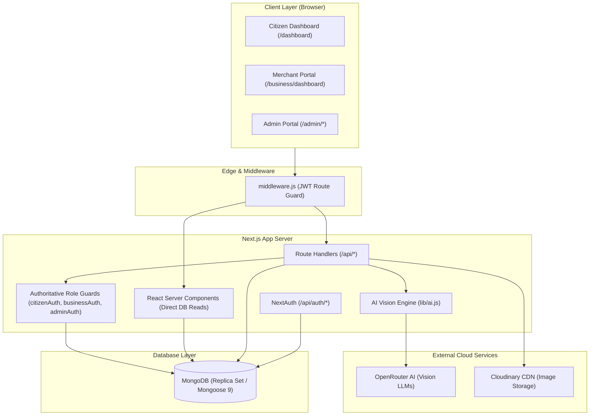
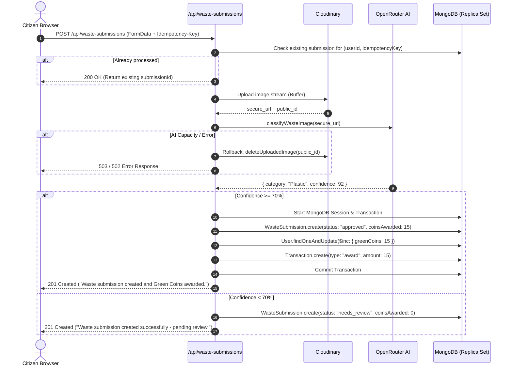

# Chapter 02 — Application Architecture & Data Flow

This chapter explains how **GreenSort** works from beginning to end, mapping the exact interactions between the browser, Next.js server, MongoDB database, Cloudinary media storage, and OpenRouter AI.

---

## 1. High-Level Architectural Flow

GreenSort is an end-to-end full-stack web application built on the **Next.js 16 App Router** paradigm. It bridges three distinct user personas into a unified circular economy loop:

1. **Citizens:** Segregate household waste, take photos, receive AI classification and instant Green Coins, and spend coins on merchant discount vouchers.
2. **Businesses:** Create reward listings, set coin costs and stock quantities, track redemption analytics, and verify customer voucher codes at point-of-sale.
3. **Administrators:** Oversee platform integrity, review low-confidence submissions, audit financial ledgers, verify or suspend businesses, manage user roles, and inspect time-series analytics.



---

## 2. Frontend Architecture: RSC vs. Client Components

A defining strength of GreenSort's Next.js architecture is its hybrid use of **React Server Components (RSC)** and **Client Components (`"use client"`)**:

### React Server Components (RSC)
- **Examples in GreenSort:**
  - `app/dashboard/page.jsx` (Citizen Dashboard)
  - `app/dashboard/transactions/page.jsx` (Transaction History)
- **How they work:** These components execute exclusively on the Node.js server during request rendering. They import Mongoose models (`User`, `WasteSubmission`, `Transaction`) and query MongoDB directly without an intermediate `fetch()` call.
- **Benefits:**
  - **Zero Client Bundle Overhead:** Mongoose and server code never ship to the browser.
  - **No Waterfalls:** HTML is pre-rendered with complete data before reaching the client.
  - **Direct Session Validation:** Uses `getServerSession(authOptions)` directly on the server.

### Client Components (`"use client"`)
- **Examples in GreenSort:**
  - `app/dashboard/submit/page.jsx` (Waste Submission Form)
  - `app/dashboard/rewards/page.jsx` (Voucher Catalog & Modal)
  - `app/business/dashboard/page.jsx` (Merchant SPA with tabs and modals)
  - `app/admin/analytics/page.jsx` (Chart.js interactive visualizations)
- **How they work:** Rendered with hydration in the browser. They manage local interactive state (`useState`, `useEffect`, `useRef`), handle browser events (file selection, clipboard copying), and dispatch asynchronous `fetch()` requests to `app/api/*` endpoints.

---

## 3. Core Subsystems & Interaction Lifecycles

### A. Waste Submission & AI Classification Pipeline
The waste lifecycle is the heart of GreenSort. When a citizen uploads a photo:
1. **Client Preparation:** The user chooses an image in `app/dashboard/submit/page.jsx`. A cryptographic UUID idempotency key is generated and linked to the file's fingerprint (`name:size:lastModified`) in browser `sessionStorage`.
2. **Server Handling (`/api/waste-submissions`):**
   - Verifies the user is an active citizen via `getAuthenticatedCitizen()`.
   - Checks MongoDB index `unique_user_waste_submission_idempotency_key` to avoid processing duplicate uploads.
   - Uploads the image buffer stream to Cloudinary (`greensort/waste-submissions`).
   - Dispatches the secure Cloudinary URL to `classifyWasteImage()` in `lib/ai.js`.
3. **AI Vision Analysis:** OpenRouter analyzes the image using multimodal LLMs (`dots-studio`, `nemotron`, or `gemma`) and returns a category and confidence percentage.
4. **Reward Evaluation & Transaction:**
   - If `confidence >= DEFAULT_CONFIDENCE_THRESHOLD` (70%), the submission status is set to `approved`, and coins are mapped using `COIN_MAPPING[category]`.
   - A MongoDB replica-set transaction atomically saves the `WasteSubmission`, increments `user.greenCoins`, marks `rewardProcessed = true`, and logs an `award` record in `Transaction`.
   - If confidence is below threshold, the record is saved with status `needs_review` and `coinsAwarded = 0`, awaiting admin moderation.
   - If any step fails after Cloudinary upload, the image is automatically deleted via `cloudinary.uploader.destroy()` to prevent orphaned assets.



---

### B. Rewards, Redemptions & Merchant Verification
The reward ecosystem provides real-world value for sorting waste:
1. **Creation:** A verified business posts a reward (e.g., "₹50 Café Discount", 500 coins, quantity: 50).
2. **Catalog Filtering:** When citizens browse rewards (`GET /api/rewards`), the query filters via `.populate({ path: "businessId", match: { verified: true, suspended: { $ne: true } } })`. Only rewards from active, non-suspended partners appear.
3. **Atomic Redemption (`POST /api/rewards/redeem`):**
   - The citizen clicks "Redeem".
   - The server begins a MongoDB transaction.
   - Atomically decrements reward stock: `Reward.findOneAndUpdate({ _id: rewardId, status: "active", quantity: { $gt: 0 } }, { $inc: { quantity: -1 } })`.
   - Atomically decrements citizen coins: `User.findOneAndUpdate({ _id: citizenId, greenCoins: { $gte: cost } }, { $inc: { greenCoins: -cost } })`.
   - Generates a unique, cryptographically random voucher code: `GS-${timeBase36}-${randomHex}` (e.g., `GS-M7X2KL-A4B9`).
   - Creates a `Redemption` document containing immutable historical snapshots of the reward title and business name.
   - Creates a `Transaction` ledger entry with negative amount (e.g., `-500`).
4. **Voucher Verification (`POST /api/business/vouchers/redeem`):**
   - Citizen shows the voucher code at the store.
   - The business enters the code on their dashboard.
   - The server verifies business ownership: `String(redemption.businessId) === String(authenticatedBusiness._id)`.
   - Uses an atomic conditional query:
     ```javascript
     Redemption.findOneAndUpdate(
       { _id: existing._id, businessId: business._id, status: "pending" },
       { $set: { status: "redeemed" } },
       { new: true }
     )
     ```
   - This ensures a code can never be redeemed twice, even under concurrent network requests.

---

### C. Admin Moderation & Ledger Audit
Administrators maintain oversight through three specialized subsystems:
1. **Waste Moderation (`/api/admin/submissions/[id]/moderate`):**
   - Admin reviews images flagged as `needs_review`.
   - If approved, a transaction updates the status to `approved`, credits the user's Green Coins, and logs the award transaction with the admin's note.
   - If rejected, a mandatory rejection reason is recorded, and status becomes `rejected` with 0 coins.
2. **Financial Ledger Audit (`/api/admin/redemptions`):**
   - Cross-checks every `Redemption` against the `Transaction` collection.
   - Evaluates whether exact coin amounts match (`item.amount === -redemption.coinsUsed`), whether `userId` matches, and whether the merchant is currently verified.
   - Returns a status of `consistent`, `warning`, or `inconsistent` for total financial transparency.
3. **Concurrency-Safe Admin Role Management (`/api/admin/users/[id]/role`):**
   - Uses a dedicated `AdminRoleGuard` singleton document in MongoDB.
   - Increments `version` inside the transaction to lock role changes and prevent the accidental demotion of the last remaining administrator.
