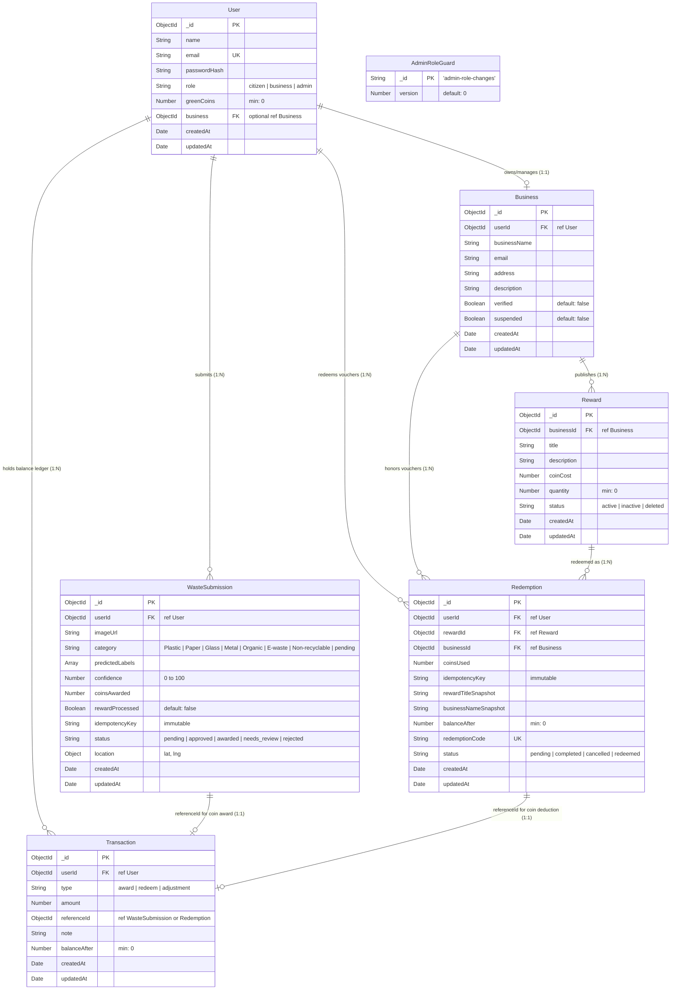

# Chapter 03 — Database Architecture & Mongoose Schemas

This chapter provides a comprehensive breakdown of the MongoDB database layer in **GreenSort**. All schemas are implemented using **Mongoose 9** with strict validation, compound indexes, partial filter expressions, and relational foreign keys (`ObjectId`).

---

## 1. Entity-Relationship (ER) Diagram

The diagram below reflects the exact schema definitions and relational references (`ref`) implemented in the codebase:



---

## 2. Detailed Schema & Field Specifications

### 1. `User` Schema (`models/User.js`)
Represents all system users (Citizens, Merchant Business Owners, and Platform Administrators).

| Field | Type | Required | Default / Constraints | Description |
| :--- | :--- | :--- | :--- | :--- |
| `_id` | `ObjectId` | Auto | Generated by MongoDB | Unique primary key. |
| `name` | `String` | **Yes** | None | Full name of the citizen or business contact. |
| `email` | `String` | **Yes** | **Unique Index** (`unique: true`) | Normalized email for login. |
| `passwordHash` | `String` | **Yes** | None | Bcrypt hashed password (10 salt rounds). |
| `role` | `String` | No | `enum: ["citizen", "business", "admin"]`, default: `"citizen"` | Role used for access control. |
| `greenCoins` | `Number` | No | `min: 0`, default: `0` | Active coin balance. Cannot drop below zero. |
| `business` | `ObjectId` | No | `ref: "Business"` | Links business users to their `Business` document. |
| `createdAt` / `updatedAt` | `Date` | Auto | `timestamps: true` | Managed automatically by Mongoose. |

---

### 2. `Business` Schema (`models/Business.js`)
Represents merchant partners who offer rewards and accept vouchers.

| Field | Type | Required | Default / Constraints | Description |
| :--- | :--- | :--- | :--- | :--- |
| `_id` | `ObjectId` | Auto | Generated by MongoDB | Unique primary key. |
| `userId` | `ObjectId` | **Yes** | `ref: "User"` | The owning user account. |
| `businessName` | `String` | **Yes** | None | Brand or commercial store name. |
| `email` | `String` | **Yes** | None | Contact email for store operations. |
| `address` | `String` | No | `""` | Physical store location for redemption. |
| `description` | `String` | No | `""` | Summary of the business. |
| `verified` | `Boolean` | No | default: `false` | Must be `true` for rewards to be visible to citizens. |
| `suspended` | `Boolean` | No | default: `false` | Set to `true` by admin to disable store redemptions. |
| `createdAt` / `updatedAt` | `Date` | Auto | `timestamps: true` | Timestamps. |

---

### 3. `Reward` Schema (`models/Reward.js`)
Represents redeemable coupons or discounts offered by businesses.

| Field | Type | Required | Default / Constraints | Description |
| :--- | :--- | :--- | :--- | :--- |
| `_id` | `ObjectId` | Auto | Generated by MongoDB | Unique primary key. |
| `businessId` | `ObjectId` | **Yes** | `ref: "Business"` | The merchant that issued this reward. |
| `title` | `String` | **Yes** | None | Reward title (e.g., "₹50 Café Discount"). |
| `description` | `String` | No | `""` | Terms or details of the reward. |
| `coinCost` | `Number` | **Yes** | `min: 1`, Integer | Green Coins required to redeem. |
| `quantity` | `Number` | **Yes** | default: `0`, Integer | Available inventory in stock. |
| `status` | `String` | No | `enum: ["active", "inactive", "deleted"]`, default: `"active"` | Lifecycle state. Deleted items are soft-deleted. |
| `createdAt` / `updatedAt` | `Date` | Auto | `timestamps: true` | Timestamps. |

---

### 4. `WasteSubmission` Schema (`models/WasteSubmission.js`)
Represents each item of household waste uploaded by a citizen for AI verification.

| Field | Type | Required | Default / Constraints | Description |
| :--- | :--- | :--- | :--- | :--- |
| `_id` | `ObjectId` | Auto | Generated by MongoDB | Unique primary key. |
| `userId` | `ObjectId` | **Yes** | `ref: "User"` | Citizen who uploaded the waste. |
| `imageUrl` | `String` | No | None | Secure HTTPS URL from Cloudinary CDN. |
| `category` | `String` | No | `enum: ["Plastic", "Paper", "Glass", "Metal", "Organic", "E-waste", "Non-recyclable", "pending"]`, default: `"pending"` | AI or Admin assigned category. |
| `predictedLabels` | `Array` | No | default: `[]` | Raw classification labels and scores. |
| `confidence` | `Number` | No | default: `0`, Range `0-100` | AI model classification confidence percentage. |
| `coinsAwarded` | `Number` | No | default: `0` | Number of Green Coins credited. |
| `rewardProcessed` | `Boolean` | No | default: `false` | True when coin transaction has completed. |
| `idempotencyKey` | `String` | No | `immutable: true` | Unique UUID from client to prevent duplicate uploads. |
| `status` | `String` | No | `enum: ["pending", "approved", "awarded", "needs_review", "rejected"]`, default: `"pending"` | Current moderation status. |
| `location` | `Object` | No | `{ lat: Number, lng: Number }` | Geographic coordinates if GPS metadata is provided. |
| `createdAt` / `updatedAt` | `Date` | Auto | `timestamps: true` | Timestamps. |

#### Critical Compound Partial Index
```javascript
WasteSubmissionSchema.index(
  { userId: 1, idempotencyKey: 1 },
  {
    unique: true,
    partialFilterExpression: { idempotencyKey: { $type: "string" } },
    name: "unique_user_waste_submission_idempotency_key",
  }
);
```
- **Why this exists:** Guarantees that if a user double-clicks the "Submit" button or if network latency triggers a browser retry, the second request fails with MongoDB duplicate key error code `11000`. The server intercepts this code and gracefully replays the existing submission without awarding double coins.

---

### 5. `Transaction` Schema (`models/Transaction.js`)
An immutable ledger documenting all Green Coin credits, debits, and adjustments.

| Field | Type | Required | Default / Constraints | Description |
| :--- | :--- | :--- | :--- | :--- |
| `_id` | `ObjectId` | Auto | Generated by MongoDB | Unique primary key. |
| `userId` | `ObjectId` | **Yes** | `ref: "User"` | Citizen whose balance is affected. |
| `type` | `String` | **Yes** | `enum: ["award", "redeem", "adjustment"]` | Direction of coin flow. |
| `amount` | `Number` | **Yes** | Positive for award, negative for redeem | Net change in coins. |
| `referenceId` | `ObjectId` | No | None | Links to `WasteSubmission._id` or `Redemption._id`. |
| `note` | `String` | No | None | Human-readable explanation. |
| `balanceAfter` | `Number` | No | `min: 0` | Snapshot of citizen balance immediately after the change. |
| `createdAt` / `updatedAt` | `Date` | Auto | `timestamps: true` | Timestamps. |

#### Critical Unique Award Index
```javascript
TransactionSchema.index(
  { referenceId: 1 },
  {
    unique: true,
    partialFilterExpression: { type: "award", referenceId: { $type: "objectId" } },
    name: "unique_award_transaction_per_reference",
  }
);
```
- **Why this exists:** Guarantees that a single `WasteSubmission` can never receive more than one `award` transaction entry in the ledger.

---

### 6. `Redemption` Schema (`models/Redemption.js`)
Represents an individual voucher purchase and tracks its usage at the merchant store.

| Field | Type | Required | Default / Constraints | Description |
| :--- | :--- | :--- | :--- | :--- |
| `_id` | `ObjectId` | Auto | Generated by MongoDB | Unique primary key. |
| `userId` | `ObjectId` | **Yes** | `ref: "User"` | Citizen who redeemed the reward. |
| `rewardId` | `ObjectId` | **Yes** | `ref: "Reward"` | The purchased reward. |
| `businessId` | `ObjectId` | **Yes** | `ref: "Business"` | The merchant who must honor the voucher. |
| `coinsUsed` | `Number` | **Yes** | None | Coins spent to purchase the voucher. |
| `idempotencyKey`| `String` | No | `immutable: true` | Prevents duplicate voucher purchases. |
| `rewardTitleSnapshot` | `String` | No | None | Historical copy of reward title at purchase time. |
| `businessNameSnapshot` | `String` | No | None | Historical copy of business name at purchase time. |
| `balanceAfter` | `Number` | No | `min: 0` | Citizen balance after coin deduction. |
| `redemptionCode` | `String` | **Yes** | **Unique Index** (`unique: true`) | Human-readable code (e.g., `GS-M7X2KL-A4B9`). |
| `status` | `String` | No | `enum: ["pending", "completed", "cancelled", "redeemed"]`, default: `"pending"` | `"pending"` until store employee redeems it. |
| `createdAt` / `updatedAt` | `Date` | Auto | `timestamps: true` | Timestamps. |

#### Critical Compound Partial Index
```javascript
RedemptionSchema.index(
  { userId: 1, idempotencyKey: 1 },
  {
    unique: true,
    partialFilterExpression: { idempotencyKey: { $type: "string" } },
    name: "unique_user_redemption_idempotency_key",
  }
);
```

---

### 7. `AdminRoleGuard` Schema (`models/AdminRoleGuard.js`)
A specialized concurrency lock collection.

| Field | Type | Description |
| :--- | :--- | :--- |
| `_id` | `String` | Constant key: `"admin-role-changes"`. |
| `version` | `Number` | Monotonically increasing sequence counter. |

- **Why it exists:** When an administrator attempts to change a user's role (such as demoting another admin), the transaction executes:
  ```javascript
  await AdminRoleGuard.findOneAndUpdate(
    { _id: "admin-role-changes" },
    { $inc: { version: 1 } },
    { new: true, session }
  );
  ```
  Because MongoDB replica sets lock the document during a write, concurrent admin demotion requests write to the same document and are serialized. This prevents two admins from demoting each other simultaneously and leaving the system without an administrator!
