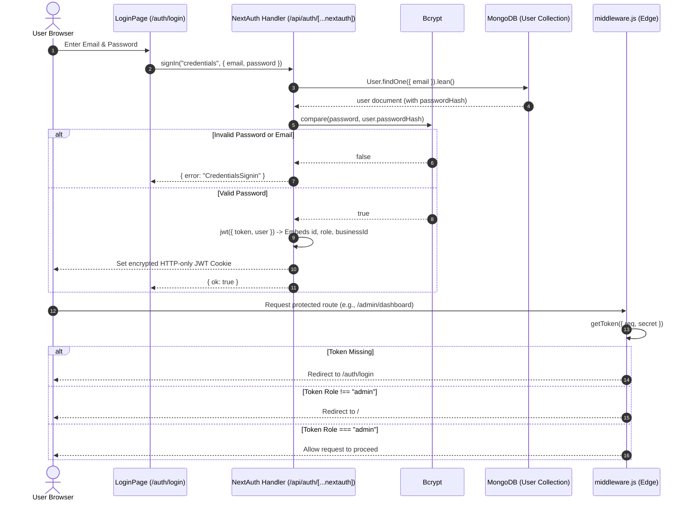

# Chapter 04 — Authentication, Session & Route Protection

This chapter breaks down the full authentication and authorization architecture of **GreenSort**. The project uses **NextAuth.js v4** with a JSON Web Token (JWT) session strategy, edge routing protection in `middleware.js`, and database-level role re-verification helpers.

---

## 1. Authentication Architecture Overview



---

## 2. NextAuth Configuration (`app/api/auth/[...nextauth]/route.js`)

The NextAuth route handler is located at `app/api/auth/[...nextauth]/route.js`. The filename uses the Next.js catch-all route syntax (`[...nextauth]`), intercepting all auth requests such as `/api/auth/signin`, `/api/auth/signout`, `/api/auth/session`, and `/api/auth/csrf`.

### Code Breakdown: `authOptions`

```javascript
// app/api/auth/[...nextauth]/route.js
export const authOptions = {
    session: { strategy: "jwt" },
    providers: [
        CredentialsProvider({
            name: "Credentials",
            credentials: {
                email: { label: "Email", type: "text" },
                password: { label: "Password", type: "password" },
            },
            async authorize(credentials) {
                if (!credentials?.email || !credentials?.password) {
                    return null;
                }
                await dbConnect();
                const user = await User.findOne({ email: credentials.email }).lean();
                if (!user) return null;
                const valid = await compare(credentials.password, user.passwordHash);
                if (!valid) return null;
                return {
                    id: user._id.toString(),
                    name: user.name,
                    email: user.email,
                    role: user.role,
                    business: user.business ? user.business.toString() : null,
                };
            },
        }),
    ],
...
```

#### Line-by-Line Explanation:
1. `session: { strategy: "jwt" }`: NextAuth will not store session state in a database collection. Instead, it signs and encrypts a compact JWT stored inside a secure, HTTP-only browser cookie.
2. `CredentialsProvider`: Allows users to sign in with an email and password against MongoDB.
3. `User.findOne({ email: credentials.email }).lean()`: Queries the user document. `.lean()` returns a plain JavaScript object instead of a heavy Mongoose document, improving speed.
4. `compare(credentials.password, user.passwordHash)`: Uses the `bcrypt` library to compute the cryptographic salt hash of the entered plaintext password and securely compare it to the stored hash.
5. If valid, returns the user object containing `id`, `name`, `email`, `role`, and `business`.

---

### Token & Session Callbacks

```javascript
    callbacks: {
        async jwt({ token, user }) {
            if (user) {
                token.user = {
                    id: user.id,
                    name: user.name,
                    email: user.email,
                    role: user.role,
                    businessId: user.business || null,
                };
            }
            return token;
        },
        async session({ session, token }) {
            if (token?.user) {
                session.user = {
                    id: token.user.id,
                    name: token.user.name,
                    email: token.user.email,
                    role: token.user.role,
                    businessId: token.user.businessId,
                };
            } else if (token?.sub) {
                session.user = {
                    ...session.user,
                    id: token.sub,
                    role: token.role ?? null,
                    businessId: token.businessId ?? null,
                };
            }
            return session;
        },
    },
    pages: {
        signIn: "/auth/login",
    },
    secret: process.env.NEXTAUTH_SECRET,
};
const handler = NextAuth(authOptions);
export { handler as GET, handler as POST };
```

#### Why these callbacks are essential:
- By default, NextAuth JWTs only store `name`, `email`, and `sub` (subject/ID).
- The `jwt()` callback runs whenever a token is created or updated. When `user` is passed (at initial login), it embeds the user's `role` and `businessId` directly into `token.user`.
- The `session()` callback runs whenever `getServerSession()` or `useSession()` is called. It extracts these properties from the decrypted token and attaches them to `session.user`.
- It includes a fallback branch (`else if (token?.sub)`) to handle edge cases or older cookies gracefully.

---

## 3. Edge Routing Protection (`middleware.js`)

Located at the project root, `middleware.js` runs on the Vercel Edge Runtime (or Node server) on every request matched by `config.matcher`.

```javascript
// middleware.js
import { NextResponse } from "next/server";
import { getToken } from "next-auth/jwt";

const PUBLIC_PATHS = ["/", "/auth/login", "/auth/register", "/api/auth", "/api/public", "/favicon.ico", "/_next"];

export async function middleware(req) {
  const { pathname } = req.nextUrl;

  // 1. Allow public paths without checking token
  if (PUBLIC_PATHS.some((p) => pathname.startsWith(p))) {
    return NextResponse.next();
  }

  // 2. Read and decrypt JWT token
  const token = await getToken({ req, secret: process.env.NEXTAUTH_SECRET });

  // 3. If unauthenticated, redirect to login
  if (!token) {
    const url = req.nextUrl.clone();
    url.pathname = "/auth/login";
    return NextResponse.redirect(url);
  }

  const role = token.user?.role || token.role || null;

  // 4. Role-based path guards
  if (pathname.startsWith("/admin") && role !== "admin") {
    return NextResponse.redirect(new URL("/", req.url));
  }

  if (pathname.startsWith("/business") && role !== "business") {
    return NextResponse.redirect(new URL("/", req.url));
  }

  if (pathname.startsWith("/dashboard") && role !== "citizen") {
    return NextResponse.redirect(new URL("/", req.url));
  }

  return NextResponse.next();
}

export const config = {
  matcher: ["/admin/:path*", "/business/:path*", "/dashboard/:path*", "/auth/:path*"],
};
```

---

## 4. Authoritative Database Role Verification Helpers

A common vulnerability in basic JWT setups is **stale role authorization**:
> *Scenario:* An administrator demotes an abusive merchant or suspends their account. However, the merchant's browser still holds a valid JWT cookie with `role: "business"` issued an hour ago.

To eliminate this vulnerability, GreenSort implements **three authoritative server guards** in `lib/`:
1. `lib/citizenAuth.js` (`getAuthenticatedCitizen`)
2. `lib/businessAuth.js` (`getAuthenticatedBusiness`)
3. `lib/adminAuth.js` (`getAuthenticatedAdmin`)

### Code Example: `lib/citizenAuth.js`

```javascript
export async function getAuthenticatedCitizen(forbiddenMessage = "Forbidden. Citizen account credentials required.") {
    let session;
    try {
        session = await getServerSession(authOptions);
    } catch {
        return { errorResponse: NextResponse.json({ error: "Unable to verify your session." }, { status: 500 }) };
    }
    if (!session?.user?.id) {
        return { errorResponse: NextResponse.json({ error: "Unauthorized. Please log in." }, { status: 401 }) };
    }

    try {
        await dbConnect();
        // RE-QUERY MONGODB TO CHECK REAL-TIME ROLE:
        const citizen = await User.findById(session.user.id).select("role greenCoins").lean();
        if (!citizen) {
            return { errorResponse: NextResponse.json({ error: "Unauthorized. Please log in." }, { status: 401 }) };
        }
        if (citizen.role !== "citizen") {
            return { errorResponse: NextResponse.json({ error: forbiddenMessage }, { status: 403 }) };
        }
        return { user: session.user, citizen };
    } catch (error) {
        return { errorResponse: NextResponse.json({ error: "Internal server error verifying citizen permissions." }, { status: 500 }) };
    }
}
```

### Key Differences between the Guards:
- **`lib/citizenAuth.js`:** Loads `greenCoins` balance alongside `role` so endpoints like `/api/rewards` know the user's real balance immediately.
- **`lib/businessAuth.js`:** Verifies that `role === "business"` and queries the `Business` collection using `{ userId: user.id }`. It returns the actual `business` document. This guarantees that `businessId` is **never trusted from client input**, preventing one merchant from modifying another merchant's rewards.
- **`lib/adminAuth.js`:** Re-queries `User.findById(id)` and ensures `dbUser.role === "admin"`.
