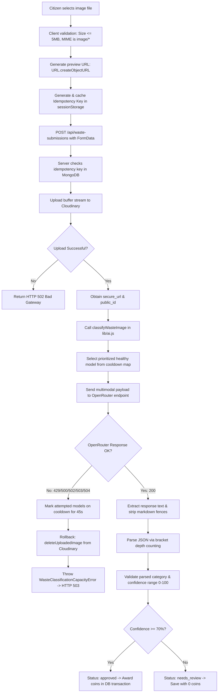

# Chapter 08 — AI Vision Classification & Image Upload Pipeline

This chapter provides an exhaustive technical analysis of GreenSort's image upload and artificial intelligence classification pipeline (`lib/ai.js`, `lib/cloudinary.js`, and `app/api/waste-submissions/route.js`).

---

## 1. Pipeline Architecture Flowchart



---

## 2. Image Upload & Cloudinary Buffer Streaming

### Validation Rules
Before any external call is initiated, `app/api/waste-submissions/route.js` enforces strict security boundaries:
1. **MIME Type Validation:** Only `image/jpeg`, `image/png`, `image/webp`, and `image/gif` are permitted.
2. **File Extension Whitelist:** File name must end with `.jpg`, `.jpeg`, `.png`, `.webp`, or `.gif`.
3. **Payload Size Guard:** Must be $> 0$ bytes and $\le 5\text{ MB}$ (`MAX_UPLOAD_SIZE_BYTES`).

### Memory Stream Upload to Cloudinary
```javascript
function uploadImage(buffer) {
    return new Promise((resolve, reject) => {
        const uploadStream = cloudinary.uploader.upload_stream({
            folder: "greensort/waste-submissions",
            resource_type: "image",
        }, (error, result) => {
            if (error) reject(error);
            else if (!result) reject(new Error("Cloudinary returned no upload result."));
            else resolve(result);
        });
        uploadStream.end(buffer);
    });
}
```
- **Why it is written this way:** Next.js App Router API handlers run serverless. Saving files to the local container disk (`fs.writeFileSync`) is unreliable because serverless containers are ephemeral and stateless. By converting the `File` into a `Buffer` (`Buffer.from(await file.arrayBuffer())`) and streaming directly to Cloudinary, no local disk space is consumed.

---

## 3. OpenRouter AI Vision Engine (`lib/ai.js`)

GreenSort connects to **OpenRouter**, an AI gateway that exposes state-of-the-art vision models through an OpenAI-compatible API at `https://openrouter.ai/api/v1/chat/completions`.

### Verified Free Vision Models
```javascript
const VERIFIED_FREE_VISION_MODELS = [
    "dots-studio/dots-3-note-preview:free",
    "nvidia/nemotron-3-nano-omni-30b-a3b-reasoning:free",
    "google/gemma-4-26b-a4b-it:free",
];
```

### Dynamic Model Prioritization & Cooldown Map
Free AI endpoints frequently experience traffic spikes or temporary 429 rate limits. Rather than failing the user immediately, `lib/ai.js` implements an in-memory cooldown state machine:

```javascript
const MODEL_COOLDOWN_MS = 60 * 1000; // 60 seconds
const modelCooldownMap = new Map();

function getPrioritizedModels() {
    const now = Date.now();
    const healthy = [];
    const coolingDown = [];
    for (const model of VERIFIED_FREE_VISION_MODELS) {
        const cooldownUntil = modelCooldownMap.get(model) ?? 0;
        if (cooldownUntil > now) {
            coolingDown.push(model);
        } else {
            healthy.push(model);
        }
    }
    const prioritized = [...healthy, ...coolingDown];
    return {
        primary: prioritized[0] ?? VERIFIED_FREE_VISION_MODELS[0],
        fallbacks: prioritized.slice(1),
    };
}
```
- **How it works:** If a model returns one of `RETRYABLE_STATUSES` (`429, 500, 502, 503, 504`), the route marks **every** attempted model on cooldown and throws `WasteClassificationCapacityError` (HTTP 503). The cooldown duration is **45 seconds** for this HTTP-error path (`markModelCooldown(model, 45 * 1000)`), while the default `MODEL_COOLDOWN_MS` of **60 seconds** is used when OpenRouter answers with a later model in the fallback list — the models it skipped are cooled down for 60 s.
- **What is not retried:** a 404 whose body says the model/endpoint is unavailable, or a 403 mentioning an *"agentic harness"* restriction, is classified as non-retryable (`model_unavailable` / `agentic_harness_restriction`) and logged with that `failureReason` before a generic error is thrown (→ HTTP 502 at the route).
- **Diagnostics:** every branch logs through `logOpenRouterFailure()` with a `stage` label (`request_failed_before_response`, `http_error_response`, `invalid_success_response_json`, `missing_classification_content`, `invalid_classification_json`, `incomplete_classification_data`, `unsupported_classification_category`, `invalid_classification_confidence`).

---

## 4. Prompt Engineering & Multimodal Payload

The classification prompt is crafted to enforce strict JSON output without conversational filler:

```text
You are a waste classification assistant for a waste segregation application.

Analyze the supplied image and classify the MAIN visible waste item.

Choose exactly one category:
Plastic, Paper, Glass, Metal, Organic, E-waste, Non-recyclable.

Return exactly one JSON object with a category string and numeric confidence from 0 to 100, such as:
{"category":"Plastic","confidence":95}

Do not add explanations or markdown.

If the image is ambiguous, choose the most likely category and lower the confidence.

Examples:
- plastic bottle → Plastic
- newspaper/cardboard → Paper
- glass bottle/jar → Glass
- aluminum/metal can → Metal
- food scraps/vegetable waste → Organic
- electronic device/circuit/charger → E-waste
- contaminated/mixed/unclassifiable waste → Non-recyclable

Do not calculate or mention Green Coins.
```

### Multimodal Message Construction
The request is dispatched using standard Chat Completion multimodal format:
```javascript
body: JSON.stringify({
    model: primaryModel,
    models: fallbackModels, // OpenRouter auto-fallbacks
    messages: [
        {
            role: "user",
            content: [
                { type: "text", text: CLASSIFICATION_PROMPT },
                { type: "image_url", image_url: { url: imageUrl } },
            ],
        },
    ],
})
```

---

## 5. Resilient JSON Extraction & Healing

LLMs occasionally wrap JSON in markdown code blocks (````json ... ````) or include leading conversational text. To prevent JSON parse errors, `lib/ai.js` features a dual-layer extraction algorithm:

```javascript
function findSingleJsonObject(value) {
    const objects = [];
    let objectStart = -1;
    let depth = 0;
    let insideString = false;
    let escaped = false;

    for (let index = 0; index < value.length; index += 1) {
        const character = value[index];
        if (insideString) {
            if (escaped) escaped = false;
            else if (character === "\\") escaped = true;
            else if (character === '"') insideString = false;
            continue;
        }
        if (character === '"') insideString = true;
        else if (character === "{") {
            if (depth === 0) objectStart = index;
            depth += 1;
        } else if (character === "}" && depth > 0) {
            depth -= 1;
            if (depth === 0) objects.push(value.slice(objectStart, index + 1));
        }
    }
    if (objects.length !== 1) throw new Error("Expected exactly one JSON object.");
    return objects[0];
}
```
- **Why this is exceptional for Viva:** The parser implements a **bracket-depth counter** that respects escaped quotes within strings. Even if the AI outputs:
  > *"Sure! Here is the classification: `{"category": "Glass", "confidence": 88}`. Hope that helps!"*
  The algorithm accurately locates `{` at depth 0, matches the closing `}` at depth 0, and extracts purely the JSON substring.

---

## 6. Diagnostic Privacy & Redaction

In production, server error logs should never leak credentials or signed asset URLs. `lib/ai.js` includes a diagnostic sanitiser:

```javascript
function sanitizeDiagnosticText(value, apiKey) {
    return value
        .replaceAll(apiKey, "[REDACTED_API_KEY]")
        .replace(/(authorization\s*[:=]\s*bearer\s+)[^\s"']+/gi, "$1[REDACTED]")
        .replace(/https?:\/\/res\.cloudinary\.com\/[^\s"']+/gi, "[CLOUDINARY_URL_REDACTED]")
        .slice(0, 3000);
}
```

- It redacts the OpenRouter API key, any `Authorization: Bearer …` value, and Cloudinary delivery URLs, and truncates every field to 3000 characters.
- It does **not** strip email addresses or phone numbers — the correct claim in a viva is *"logs are limited to sanitised provider output: key, bearer token, and image URL redaction plus length caps"*, not *"all PII is redacted"*.
- `getSafeChoiceMessageKeys()` goes one step further and logs only the **field names** of `choices[0].message` (never its content) when the model returns no usable text.

---

## 7. Relevant Environment Variables

| Variable Name | Purpose | Sensitivity |
| :--- | :--- | :--- |
| `OPENROUTER_API_KEY` | Bearer token used to authenticate requests against OpenRouter. **Required** — the route returns 503 *"AI image classification is not configured."* when it is missing. It is *not* listed in `.env.local.example`, so add it yourself. | **High Secret** (Server only) |
| `CLOUDINARY_CLOUD_NAME` | Cloudinary account namespace for asset hosting. | Medium (Server only) |
| `CLOUDINARY_API_KEY` | Cloudinary API access key. | **High Secret** (Server only) |
| `CLOUDINARY_API_SECRET` | Cloudinary API secret for signing stream uploads. | **High Secret** (Server only) |
| `CONFIDENCE_THRESHOLD` | Minimum percentage (default: `70`) required to automatically approve waste and award coins. | Public / Config |
| `MAX_UPLOAD_SIZE_BYTES` | Server-side maximum image size in bytes (default: `5242880` = 5 MB). | Public / Config |
| `NEXT_PUBLIC_MAX_UPLOAD_SIZE_BYTES` | Optional client-side mirror of the same limit used by `app/dashboard/submit/page.jsx`. Not present in `.env.local.example`; the client falls back to 5 MB. If you raise the server limit, raise this one too or the browser will reject the file before the request is sent. | Public / Config |
| `GOOGLE_VISION_API_KEY` | Listed in `.env.local.example` as an optional legacy placeholder; the active implementation uses OpenRouter. | Optional |
